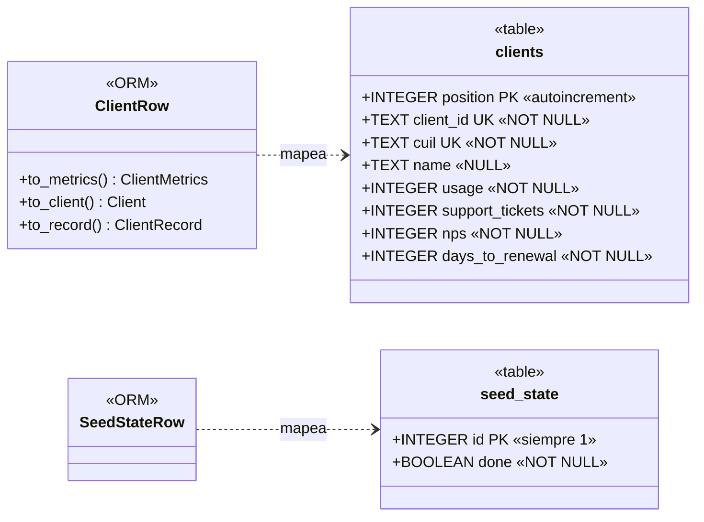

# UML de la base de datos

Base SQLite gestionada con SQLAlchemy. Fuente: [src/health_score/data/sql.py](../src/health_score/data/sql.py)
(tablas definidas en spec 003, [data-model.md](../specs/003-client-persistence-crud/data-model.md)).

## Notas

- **Sin relaciones**: las dos tablas son independientes; no hay claves foráneas.
- **`clients.position`** es la clave física (SQLite solo autoincrementa un `INTEGER PRIMARY KEY`)
  y conserva el orden de alta; **`client_id`** es la clave lógica (`C-001`… en la carga inicial,
  UUID v4 en altas por API).
- **`cuil`**: 11 dígitos sin guiones, guardado como texto. Su unicidad produce el 409 de la API.
- **Métricas** (`usage`, `support_tickets`, `nps`, `days_to_renewal`): sin `CHECK` en la base; los
  rangos se validan en `METRIC_RANGES` (Pydantic).
- **`seed_state`**: la fila existe ⇔ la carga inicial ya se ejecutó; se escribe en la misma
  transacción que la carga.
- La consulta al BCRA (spec 005) no persiste datos: no agrega tablas.
